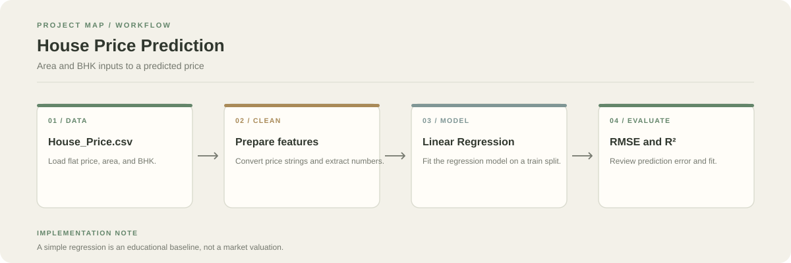

# House Price Prediction

A Jupyter notebook project that predicts flat prices from area and BHK count using Linear Regression. The notebook covers cleaning, exploratory data analysis, train/test splitting, model fitting, and evaluation.

**Stack:** Python, Pandas, NumPy, Matplotlib, Seaborn, scikit-learn, Jupyter



## Workflow

1. Load `House_Price.csv`.
2. Convert price values such as lakhs/crores to numeric values and extract area and BHK count.
3. Explore relationships between features and price.
4. Split the data, fit Linear Regression, and evaluate using Mean Squared Error and R².

## Run

```bash
git clone https://github.com/chyk2468/House-Price-Prediction.git
cd House-Price-Prediction
pip install pandas numpy matplotlib seaborn scikit-learn jupyter
jupyter notebook "House Price Prediction.ipynb"
```

Keep `House_Price.csv` in the notebook's working directory.

## Limitations

The model uses a small set of features and does not account for every factor that influences real property prices, such as locality, age, amenities, market movement, or legal status. Use it as a learning exercise rather than financial advice.
