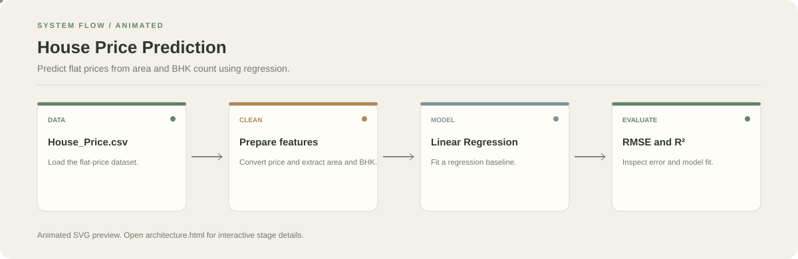

# House Price Prediction

**Predict flat prices from area and BHK count using regression.**

[](https://github.com/chyk2468/House-Price-Prediction)

## 1. Project Title & Tagline

Predict flat prices from area and BHK count using regression.

## 2. Problem Statement

Property prices vary with many factors, and simple estimates can be difficult to compare. This notebook demonstrates a basic regression model using a small set of housing features.

## 3. Project Preview

Add a screenshot or short GIF for each main module and link a live demo only where one exists.

[Open interactive architecture](architecture.html)

## 4. Overview

The repository groups several applications, so each module may have its own frontend, backend, dependencies, and run commands. Use the module-specific instructions rather than assuming one command starts everything.

## 5. Key Features

- Load and clean flat-price data.
- Convert price values into numeric values.
- Explore relationships between area, BHK, and price.
- Train and evaluate a Linear Regression baseline.

## 6. Architecture / Workflow



Open the [interactive architecture explorer](architecture.html) to select a stage and inspect its role.

## 7. Tech Stack

Python, Pandas, NumPy, Matplotlib, Seaborn, scikit-learn, Jupyter

## 8. Installation & Setup

```bash
git clone https://github.com/chyk2468/House-Price-Prediction.git
cd House-Price-Prediction
pip install pandas numpy matplotlib seaborn scikit-learn jupyter
jupyter notebook "House Price Prediction.ipynb"
```

## 9. Usage

Keep `House_Price.csv` in the notebook's working directory, execute the notebook cells in order, and review the prediction plots and evaluation metrics.

## 10. Project Structure

- `House Price Prediction.ipynb`: data exploration, preprocessing, training, and evaluation
- `House_Price.csv`: dataset input

## 11. Results & Demo

Record the train/test split, RMSE, R², and a plot of predicted versus actual prices after executing the notebook.

## 12. Future Enhancements

- Add locality and property-age features if data is available.
- Compare linear regression with tree-based baselines.
- Add cross-validation and residual analysis.
- Document data source and units clearly.

## 13. License

Check the dataset and source-code licences before redistribution.
